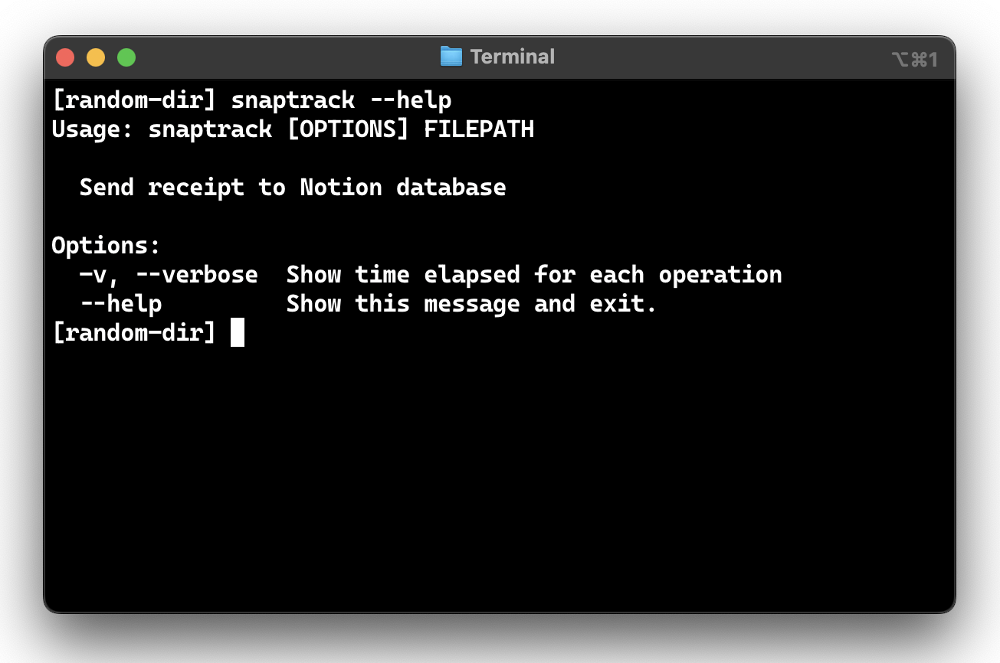

# SnapTrack

SnapTrack is a Python CLI tool that uses AWS Rekognition for image processing and GPT for intelligent text extraction.

Snap a photo of a receipt, provide its file path, and SnapTrack will extract each item and update your Notion page automatically — no manual entry required.

It’s a simple way to streamline expense tracking and keep your finances organized, so you can focus on what matters most.

<p align="center">
  
</p>

## Demo

Experience the application with a demonstration using a sample receipt sourced from [Pinterest](#credits).

Watch as each item is automatically extracted and entered into the database.

https://github.com/isobarbaric/SnapTrack/assets/76544615/d0f43ee2-c986-4207-a8dd-fe10cbfd049e

### Enhancing Visibility with the `--verbose` Flag

Use the --verbose flag for a detailed view of the application's execution.

Watch the full demo [here](https://github.com/isobarbaric/SnapTrack/assets/76544615/0bec78af-45e3-4fd3-869d-11bb43843e04).

## Installation
1. Install Poetry
```
pip install poetry
```

2. Clone this repository:
```
git clone https://github.com/isobarbaric/SnapTrack
```

3. Navigate to the cloned directory (and in the root directory):
```
cd SnapTrack
```

4. Build the wheel for the module:
```
poetry build
```

5. Install the module:
```
pip install dist/snaptrack-0.1.0-py3-none-any.whl
```

Now, you can use the `snaptrack` command from your terminal.

## Usage
To run SnapTrack, use:
``snaptrack FILEPATH``

For more information, feel free to use the ``--help`` flag.

## Credits
- Image from [Pinterest](https://www.pinterest.ca/pin/receipt--282952789077533732/)
